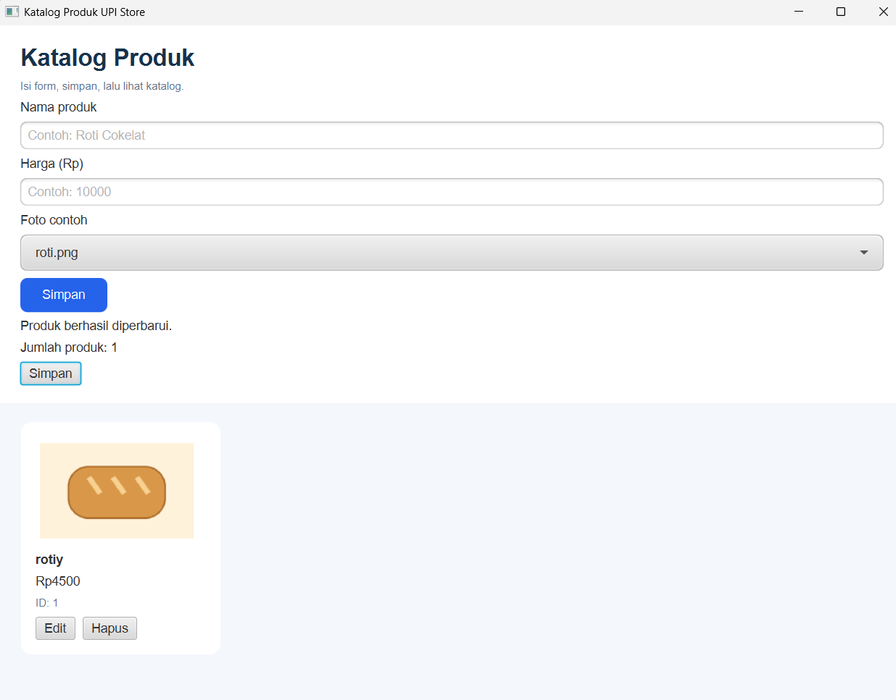
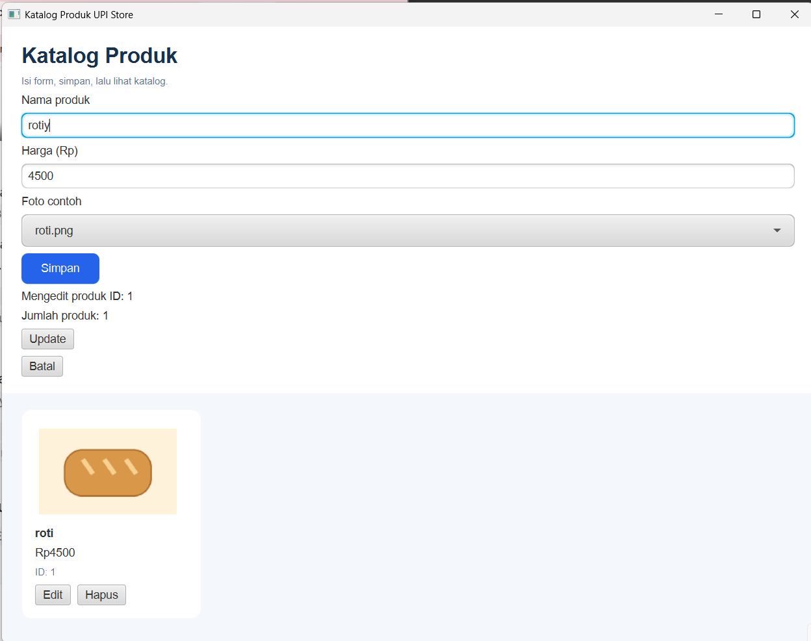

# Katalog Produk

> Aplikasi desktop katalog produk berbasis **JavaFX 21** & **SQLite**. Berbeda dari aplikasi CRUD konvensional yang kaku berbasis tabel, aplikasi ini mengusung antarmuka modern berbasis kartu (*card grid*).

---

## Preview

| Katalog Produk (Card View) | Mode Edit Adaptif |
| :---: | :---: |
|  |  |

---

## Ciri Khas & Keunggulan

1. **Card-Based UI (Bukan TableView Biasa)**  
   Produk disajikan dalam bentuk kartu interaktif (*TilePane + ScrollPane*) lengkap dengan pratinjau gambar, badge harga, dan tombol aksi langsung di setiap kartu.
2. **Formulir Cerdas & Adaptif**  
   Satu form untuk dua mode: otomatis bertransisi dari mode **Simpan** ke mode **Update** (dan menampilkan tombol **Batal**) saat kartu dipilih untuk diedit, tanpa perlu membuka pop-up baru.
3. **Validasi Berlapis (Dual-Layer Integrity)**  
   Keamanan data dijaga dari dua sisi: validasi logika bisnis di entity Java (`IllegalArgumentException`) dan batasan ketat langsung di SQLite (`CHECK constraint`).
4. **Zero-Configuration SQLite**  
   Database lokal (`data/katalog.db`) dibuat dan diinisialisasi otomatis saat pertama kali aplikasi dijalankan—tanpa perlu instalasi atau setup server database.

---

## Tech Stack

- **Core**: Java 17, JavaFX 21 (Controls & FXML)
- **Database**: SQLite via `sqlite-jdbc`
- **Build**: Apache Maven

---

## Cara Menjalankan

**Prasyarat:** JDK 17+ & Maven

```bash
# 1. Clone repositori
git clone https://github.com/dyynn555/Katalog-Produk.git
cd Katalog-Produk

# 2. Jalankan aplikasi
mvn clean javafx:run
```
